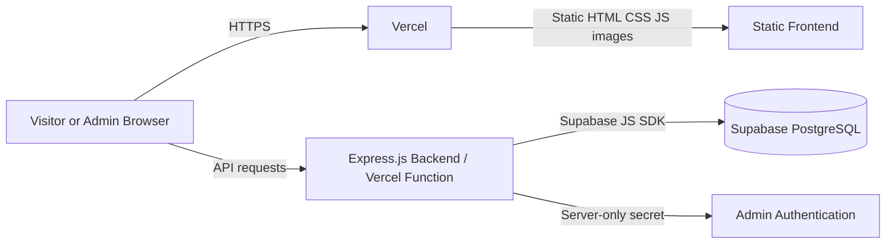
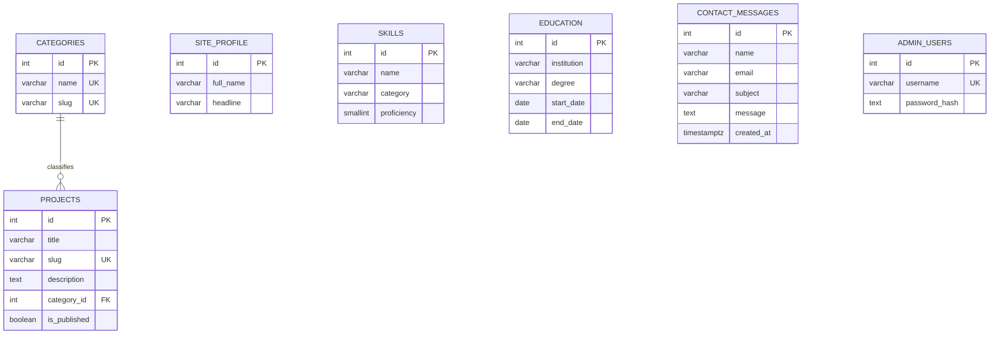

# Technical Requirements Document (TRD)
## Dynamic Personal Portfolio Website with Admin Dashboard

| Field | Value |
|---|---|
| **Course** | Web Engineering (Complex Engineering Problem), Department of Computer Systems Engineering, Mehran University of Engineering and Technology, Jamshoro |
| **Instructor** | Engr. Zoha Memon |
| **Submission deadline** | 14-11-2026 |
| **Document version** | 2.0 (Revised draft) |
| **Document date** | 11-11-2026 |
| **Author** | [Student Name] |
| **Companion document** | `PRD.md` |
| **Status** | Revised for review; Phase 2 begins after approval. |

> This document describes the intended design. It does not claim that the application has already been implemented. Code is developed in Phases 3 and 4.

---

## Table of Contents

1. Introduction
2. Technical Decisions and Constraints
3. Final Technology Stack and Justification
4. System Architecture
5. Frontend Architecture
6. Backend Architecture
7. Database Architecture
8. Supabase Security and Row Level Security
9. Authentication and Authorization
10. API and Route Design
11. Input Validation and Security
12. Suggested Folder Structure
13. Development Environment Setup
14. Testing Strategy
15. Deployment Strategy
16. Development Phases
17. Risk Register
18. Open Items and Verification

---

## 1. Introduction

### 1.1 Purpose

This document defines the technical design for the dynamic personal portfolio described in `PRD.md`. It records the selected technologies, architecture, database schema, authentication, security, testing and deployment approach.

### 1.2 Guiding principles

1. Meet the university requirements before adding optional features.
2. Keep the stack beginner-friendly: HTML, CSS, Bootstrap, Vanilla JavaScript, Node.js, Express.js and Supabase.
3. Use a relational database and retrieve public content dynamically.
4. Validate every submitted value on the server; browser validation is only for user experience.
5. Keep secrets on the server and protect every admin route.
6. Design for Vercel's serverless execution: no reliance on persistent local files or in-memory sessions.
7. Build in small phases and avoid adding frameworks that are not required.

---

## 2. Technical Decisions and Constraints

| ID | Constraint / decision | Resolution |
|---|---|---|
| TD-01 | The assignment describes PHP, but the owner has confirmed that the instructor permits Express.js instead. | Use Node.js + Express.js and document the approved substitution in the technical report. If the instructor changes this decision, reassess before implementation. |
| TD-02 | The assignment permits MySQL or another relational DBMS. | Use Supabase PostgreSQL, which is relational and supports constraints, indexes and RLS. |
| TD-03 | Vercel executes backend code using function/serverless infrastructure. | Keep request handling stateless. Do not rely on local disk or in-memory sessions surviving between invocations. |
| TD-04 | Supabase service-role credentials bypass RLS. | Keep the service-role key exclusively in server environment variables. Express.js performs admin authorization before privileged operations. Public browser access uses no service-role key. |
| TD-05 | A large admin system could exceed the deadline. | Required admin feature is project CRUD. Skills/education CRUD, category management and a full message inbox are optional unless time remains. |
| TD-06 | The site needs four pages and dynamic content. | Use a traditional multi-page frontend with static HTML files and client-side JavaScript; Express exposes data and form endpoints. |
| TD-07 | Public and admin data have different access needs. | Public endpoints return only published portfolio content. Admin endpoints require a valid authenticated admin session/token. |
| TD-08 | Contact forms can be abused. | Validate server-side, limit request frequency, use a honeypot and CSRF protection, and escape message content when displayed. |

---

## 3. Final Technology Stack and Justification

### 3.1 Selected stack

| Layer | Technology | Purpose |
|---|---|---|
| Markup | HTML5 | Four public pages and admin screens |
| Styling | CSS3 + Bootstrap 5.3 | Responsive layout and components |
| Client scripting | Vanilla JavaScript (ES6+) | Search, filters, theme, form validation and interactions |
| Backend runtime | Node.js (current LTS supported by Vercel) | Server-side JavaScript runtime |
| Backend framework | Express.js | Routes, middleware, validation and admin endpoints |
| Database | Supabase PostgreSQL | Relational persistent data store |
| Database SDK | `@supabase/supabase-js` | Server-side queries and inserts/updates/deletes |
| Authentication | `bcrypt` (or `bcryptjs`) + signed JWT in HttpOnly cookie | Single-admin login with a fixed 30-minute token lifetime and no in-memory session store |
| Validation | Express-side validation (for example `express-validator`) | Authoritative server-side input checks |
| Hosting | Vercel | Static frontend and Express backend deployment |
| Version control | Git + GitHub | Source history and automatic Vercel deployments |
| Development tools | VS Code, Node.js, npm, browser developer tools | Local development and testing |

Exact package versions are selected and locked in `package-lock.json` during implementation. Do not copy unverified version numbers into the documents.

### 3.2 Why this stack

- **HTML/CSS/Bootstrap:** directly satisfies the assignment's responsive interface requirement and is straightforward to explain.
- **Vanilla JavaScript:** enough for the required interactions without React or a frontend build framework.
- **Node.js + Express.js:** instructor-approved alternative to PHP; one language is used for frontend interactions and backend logic.
- **Supabase PostgreSQL:** managed relational database with a dashboard, SQL editor, constraints and RLS.
- **`@supabase/supabase-js`:** official JavaScript client for database operations; avoids manually managing raw database connections.
- **Vercel:** hosts the static frontend and Node/Express backend, with Git-based deployments.

### 3.3 Alternatives considered

| Decision | Selected | Alternatives | Reason |
|---|---|---|---|
| Backend | Express.js | PHP, Flask, FastAPI | Express.js is explicitly approved by the instructor and uses JavaScript already used in the frontend. |
| Frontend | HTML/CSS/Bootstrap/Vanilla JS | React, Vue, Angular | Assignment does not require a frontend framework; avoiding one reduces setup and learning overhead. |
| Database | Supabase PostgreSQL | MySQL, SQLite | Cloud-hosted relational DB is accessible to the deployed backend and meets the assignment. |
| DB integration | Supabase JS SDK | Direct `pg` connection | SDK integrates with Supabase and supports the required operations with less connection configuration. |
| Hosting | Vercel | Render, Railway, traditional shared hosting | Owner's selected platform; supports Node.js/Express deployments and static assets. |
| Authentication | Password hash + signed token cookie | Supabase Auth, express-session with external store | A single-admin implementation can remain small and stateless. If implementation complexity or refresh-token handling becomes problematic, reassess with instructor/owner before changing the design. |

---

## 4. System Architecture

### 4.1 High-level architecture



### 4.2 Application style

A traditional multi-page website with a small JSON API:

- Vercel serves the public HTML, CSS, JavaScript and image files.
- The browser calls Express API routes to retrieve dynamic projects, skills, education and profile data.
- The Express backend validates contact form submissions and writes them to Supabase.
- Admin routes check the authentication token before any protected operation.
- Static assets are not uploaded through the Express server; images are repository assets or externally hosted URLs.

### 4.3 Request lifecycle: public projects

1. Browser loads `/projects.html` from Vercel.
2. `projects.js` calls `GET /api/projects`.
3. Express queries Supabase for published projects and their category information.
4. Express returns a JSON response containing only public fields.
5. JavaScript renders the project cards and enables search/filter controls.

### 4.4 Request lifecycle: add project

1. Admin submits the project form from the dashboard.
2. Browser sends a `POST /api/admin/projects` request with the authentication cookie and CSRF token.
3. Express authentication middleware verifies the signed token and admin identity.
4. Validation middleware checks all fields and allowed URL formats.
5. Express uses the server-side Supabase client to insert the record.
6. Express returns a success response; the dashboard refreshes the project list.

### 4.5 Vercel execution model

The Express application must be exportable for Vercel's supported Node.js deployment model. Local development may start a normal HTTP server, while production exports the Express app for the Vercel runtime. Keep the startup/listen code separate from the exported app. Follow the current Vercel Express example and deployment documentation when choosing the exact entry file and configuration; do not assume a long-running server or durable process memory.

Static files should be served as Vercel static assets. For local development, Express may serve the `public/` directory. Production routing must be tested so API requests reach Express and static files remain accessible.

---

## 5. Frontend Architecture

### 5.1 Public pages

| File | Main content | Dynamic data |
|---|---|---|
| `index.html` | Hero, about summary, featured projects | Profile and featured projects |
| `skills-education.html` | Skills grouped by category and education timeline | Skills and education |
| `projects.html` | Search, filters and project cards/details | Published projects and categories |
| `contact.html` | Contact details and contact form | Profile contact details; form posts to API |

### 5.2 Admin pages

- `admin/login.html`: login form.
- `admin/index.html`: dashboard summary.
- `admin/projects.html`: list, create, edit and delete projects.
- Optional later pages: skills, education and message inbox.

All admin HTML files are not a security boundary. Every API request must be authorized on the server.

### 5.3 Frontend files and interactions

| JavaScript file | Responsibility |
|---|---|
| `main.js` | Shared navigation behaviour and common UI setup |
| `theme.js` | Light/dark theme toggle; persist preference in `localStorage` |
| `projects.js` | Fetch projects, render cards, live search and category/technology filters |
| `skills.js` | Skill-bar animation with `IntersectionObserver`; experience calculation from dates |
| `contact.js` | Client-side contact validation and API submission |
| `admin.js` | Admin API calls, project forms, delete confirmation and feedback |

### 5.4 Frontend rules

- Use semantic HTML and one clear `h1` per page.
- Use Bootstrap 5.3 grid, navbar, cards, forms, modal and utility classes.
- Keep custom design rules in `public/assets/css/style.css`.
- Load scripts with `defer` or modules; avoid inline event handlers.
- Render database text as text, not as executable HTML. Prefer `textContent` and safe DOM APIs; sanitize only if rich text is explicitly supported.
- Validate external URLs and allow only `http` or `https` before creating links.
- Include labels, visible focus styles, alt text and reduced-motion support.
- Test widths 320, 375, 768, 1024 and 1440 px.

---

## 6. Backend Architecture

### 6.1 Responsibilities

Express.js is responsible for:

- API routing and HTTP status codes.
- Public data retrieval from Supabase.
- Contact form validation and message storage.
- Admin login, token verification and authorization.
- Project CRUD and optional admin modules.
- Central error handling, security headers and rate limiting.

### 6.2 Suggested backend layers

| Layer | Example location | Responsibility |
|---|---|---|
| App setup | `server/app.js` | Create Express app and register middleware/routes |
| Local startup | `server/index.js` | Start local HTTP server only; not used as persistent production state |
| Supabase clients | `server/config/supabase.js` | Create server-side public and privileged clients from environment variables |
| Routes | `server/routes/*.js` | Map HTTP methods and paths to controllers |
| Controllers | `server/controllers/*.js` | Handle request/response and call services |
| Services | `server/services/*.js` | Supabase data operations and business logic |
| Middleware | `server/middleware/*.js` | Authentication, validation, rate limiting, error handling |
| Validators | `server/validators/*.js` | Reusable field validation rules |
| Utilities | `server/utils/*.js` | Token, escaping/formatting and response helpers |

For a small assignment, these may be combined into fewer files. Keep responsibilities understandable rather than creating many empty folders.

### 6.3 Supabase client configuration

Use two clearly separated server-side access patterns:

1. **Public client:** initialized with `SUPABASE_URL` and `SUPABASE_ANON_KEY` (or the current publishable key). RLS policies allow only the public reads and contact inserts required by the site.
2. **Privileged server client:** initialized with `SUPABASE_URL` and `SUPABASE_SERVICE_ROLE_KEY`. This client is used only inside protected Express handlers after admin authorization. The service-role key bypasses RLS and must never appear in browser JavaScript, HTML, logs or Git history.

Disable unnecessary auth-session persistence/refresh behaviour on server-side Supabase clients. Reuse configured clients within a warm function instance, but do not depend on their memory for correctness.

### 6.4 Error handling

- Use a central Express error middleware.
- Return consistent JSON errors without stack traces or secrets.
- Log diagnostic details server-side only.
- Use `400` for invalid input, `401` for missing/invalid authentication, `403` for forbidden actions, `404` for missing records and `500` for unexpected failures.
- Do not send raw Supabase error objects to the browser.

---

## 7. Database Architecture

### 7.1 Database conventions

- Supabase PostgreSQL, `public` schema.
- Lowercase `snake_case` table and column names.
- Primary keys use identity integer columns unless a UUID is more suitable.
- Use `timestamptz` for timestamps and database constraints for integrity.
- SQL scripts are stored in `database/` and committed to Git; secrets are never stored in SQL files.

### 7.2 Entity relationships



### 7.3 Core tables

**`site_profile`** — one row containing full name, headline, tagline, short/long bio, profile image URL, location, public email, resume URL, GitHub URL, LinkedIn URL and career start date. Use a check constraint to keep the singleton row at a known ID.

**`categories`** — `id`, `name` (unique), `slug` (unique).

**`projects`** — `id`, `title`, `slug` (unique), `summary`, `description`, nullable `category_id` (foreign key with `ON DELETE SET NULL`), `tech_stack` (simple text/JSON array for this small project), `image_url`, `live_url`, `repo_url`, `project_date`, `is_featured`, `is_published`, `display_order`, `created_at`, `updated_at`.

**`skills`** — `id`, `name`, `category`, `proficiency` (integer 0–100), optional `started_on`, optional `icon_name`, `display_order`.

**`education`** — `id`, `institution`, `degree`, optional `field_of_study`, `start_date`, nullable `end_date`, optional `grade`, optional `description`, `display_order`. A check constraint ensures end date is not earlier than start date.

**`contact_messages`** — `id`, `name`, `email`, `subject`, `message`, `created_at`, optional `is_read`, optional `ip_hash`. Apply sensible length checks. Do not store a raw IP address unless there is a documented need.

**`admin_users`** — `id`, unique `username`, `password_hash`, `created_at`, optional `last_login_at`, optional `failed_attempts` and `locked_until`.

### 7.4 Indexes and constraints

- Unique indexes for project slug, category name/slug and admin username.
- Index `projects(is_published, display_order)` for public project listing.
- Index `projects(category_id)` for filtering.
- Index `contact_messages(created_at DESC)` if an inbox is implemented.
- `CHECK (proficiency BETWEEN 0 AND 100)` on skills.
- `CHECK (end_date IS NULL OR end_date >= start_date)` on education.
- Required fields use `NOT NULL`; category deletion uses `ON DELETE SET NULL`.

### 7.5 SQL deliverables

| File | Purpose |
|---|---|
| `database/schema.sql` | Tables, constraints and indexes |
| `database/rls.sql` | RLS enablement and policies for public/anon access |
| `database/seed.sql` | Clearly labelled placeholder profile, projects, skills, education and categories |

The final SQL scripts must be tested by importing them into a clean Supabase project or a fresh schema before submission.

---

## 8. Supabase Security and Row Level Security

### 8.1 RLS strategy

Enable RLS on all tables exposed through the Supabase Data API. Define only the public policies needed:

- `site_profile`: public `SELECT` of the profile row.
- `projects`: public `SELECT` only where `is_published = true`.
- `categories`: public `SELECT` for categories used by published projects.
- `skills` and `education`: public `SELECT`.
- `contact_messages`: no public `SELECT`, `UPDATE` or `DELETE`; public insert is allowed only if the contact form uses the public client and strict column/data validation is enforced. Otherwise submit through a server-only privileged client.
- `admin_users`: no public access.

### 8.2 Service-role key warning

The Supabase service-role key bypasses RLS. This is expected for server-side admin operations, but it means RLS alone does not protect against mistakes inside Express. Therefore:

1. Keep the key only in Vercel environment variables and a local ignored `.env` file.
2. Never expose it through frontend environment variables, JSON responses or browser bundles.
3. Authenticate and authorize every admin request before using the privileged client.
4. Keep privileged database operations inside a small set of protected service functions.
5. Do not use the privileged client for ordinary public reads when the public client and RLS are sufficient.

### 8.3 Verification

During Phase 3, test that the anon/publishable key can read only intended public data and cannot read admin users or contact messages. Separately test that protected Express routes can perform the required admin operations only after successful authentication.

---

## 9. Authentication and Authorization

### 9.1 Single-admin model

The application has one administrator. Visitors can view public portfolio data and submit a contact message. Only the administrator can access dashboard APIs and required project CRUD routes. Contact messages are stored in Supabase; a dashboard inbox is optional.

### 9.2 Login design

1. Admin submits username and password to `POST /api/auth/login`.
2. Express validates the fields and fetches the admin record using the server-side Supabase client.
3. The password is checked with `bcrypt.compare()` against the stored hash.
4. On success, Express signs a JWT using a strong `JWT_SECRET`, sets its expiry to 30 minutes, and sends it in an `HttpOnly`, `Secure` (production), `SameSite=Lax`, `Path=/` cookie.
5. Admin routes use authentication middleware to verify the signature, expiry and admin identity on every request. The token has a fixed lifetime; it is not an inactivity-tracking session.
6. Logout clears the authentication cookie using the same cookie name and path.

Do not store plaintext passwords. Create the initial admin with a one-time setup script that hashes the password. Do not commit the actual password or hash to source control.

### 9.3 Stateless deployment notes

Do not use Express's default in-memory session store in production. A signed token cookie avoids relying on server memory across Vercel invocations. Use a fixed 30-minute token lifetime and require login again after expiry. This is a fixed session lifetime, not true inactivity detection; do not describe it as an inactivity timeout. If immediate token revocation, refresh-token rotation or true inactivity tracking becomes necessary, use a persistent session store or Supabase Auth after reviewing the extra implementation scope.

### 9.4 Cookie and CSRF controls

**Authentication cookie**
- Name it consistently (for example, `portfolio_admin`).
- Set `HttpOnly`, `Secure` in production, `SameSite=Lax`, `Path=/`, and `Max-Age=1800`.
- The JWT expiry must also be 30 minutes. Clear the cookie on logout using the same name and path.
- Never put the JWT in `localStorage`, page markup or a JavaScript-readable cookie.

**CSRF protection: signed double-submit cookie**
1. Provide a `GET /api/csrf` endpoint that creates a cryptographically random CSRF value, signs it with a server-only `CSRF_SECRET` (or a separately derived HMAC key), sets the signed value in a JavaScript-readable `SameSite=Lax` cookie, and returns the token value in JSON.
2. Before any state-changing request, the frontend sends the returned token in the `X-CSRF-Token` header. This applies to login, contact submission, project create/update/delete and any optional admin mutation.
3. Middleware requires the header token to match the CSRF cookie and verifies its signature using a timing-safe comparison. Reject missing, mismatched or invalid tokens.
4. Also validate the request `Origin` against the deployed site origin when an Origin header is present. Use HTTPS in production.
5. The CSRF cookie must not contain authentication credentials. The authentication cookie remains HttpOnly.

Apply login rate limiting and generic invalid-credential messages. Do not exempt a state-changing endpoint from CSRF protection without documenting and justifying the exception.

### 9.5 Authorization rules

- Public endpoints expose only public fields and published projects.
- Every `/api/admin/*` endpoint requires authentication middleware.
- Do not rely on hiding admin pages or buttons as access control.
- Validate record IDs and confirm the target exists before updating/deleting.

---

## 10. API and Route Design

### 10.1 Public routes

| Method | Endpoint | Purpose |
|---|---|---|
| GET | `/api/profile` | Get public profile details |
| GET | `/api/projects` | Get published projects; optional category/technology query filters |
| GET | `/api/skills` | Get skills |
| GET | `/api/education` | Get education records |
| POST | `/api/contact` | Validate and store a contact message |

### 10.2 Authentication routes

| Method | Endpoint | Purpose |
|---|---|---|
| POST | `/api/auth/login` | Authenticate the admin and set the auth cookie |
| POST | `/api/auth/logout` | Clear the auth cookie |
| GET | `/api/auth/me` | Return current admin authentication status |

### 10.3 Admin routes

All routes below require authentication:

| Method | Endpoint | Purpose |
|---|---|---|
| GET | `/api/admin/projects` | List all projects, including drafts |
| POST | `/api/admin/projects` | Create a project |
| PUT/PATCH | `/api/admin/projects/:id` | Update a project |
| DELETE | `/api/admin/projects/:id` | Delete a project |

Optional later endpoints may manage skills, education, categories and contact inbox messages. They are not required before the core assignment features work. Public skills and education endpoints remain required because those records must load dynamically.

### 10.4 API response conventions

Success responses use JSON with a predictable shape, for example `{ "data": ..., "message": "..." }`. Errors use `{ "error": { "message": "...", "fields": ... } }` without stack traces or database credentials.

| Status | Meaning |
|---|---|
| 200 | Successful read/update |
| 201 | Record created |
| 204 | Record deleted successfully |
| 400 | Invalid input |
| 401 | Missing or invalid authentication |
| 403 | Authenticated but not permitted / CSRF failure |
| 404 | Resource not found |
| 429 | Rate limit exceeded |
| 500 | Unexpected server error |

---

## 11. Input Validation and Security

### 11.1 Validation principles

1. Browser validation improves usability but is never trusted.
2. Express validates every field again before database operations.
3. Database constraints enforce critical integrity rules.
4. Trim text, check types, lengths, formats and allowed values.
5. Escape or safely render content at output time; do not store HTML-escaped text as the primary value.

### 11.2 Contact form rules

| Field | Rule |
|---|---|
| Name | Required; 2–100 characters |
| Email | Required; valid email; maximum 254 characters |
| Subject | Required; 3–150 characters |
| Message | Required; 10–2000 characters |
| Honeypot | Must remain empty |
| CSRF | Must be valid for the request |

### 11.3 Project form rules

| Field | Rule |
|---|---|
| Title | Required; 3–150 characters |
| Summary | Required; 10–300 characters |
| Description | Required; maximum 5000 characters |
| Category | Existing category ID or null |
| Technologies | Trimmed list; reasonable maximum length |
| Image/live/repository URLs | Optional; valid `http` or `https` URL, or approved local asset path |
| Project date | Optional valid date |
| Featured/published | Boolean values only |

### 11.4 Security checklist

- Use `helmet` or equivalent security headers.
- Configure CORS narrowly; if frontend and API share the same Vercel origin, avoid permissive CORS.
- Use rate limiting for login and contact endpoints.
- Validate and normalize input on the server.
- Use Supabase client methods with values passed as data; never concatenate user input into raw SQL.
- Escape dynamic text in HTML; use `textContent` in frontend rendering.
- Restrict URLs to safe protocols.
- Keep secrets in environment variables and `.env` in `.gitignore`.
- Do not log passwords, tokens, full contact messages or secrets.
- Return generic errors to visitors; keep detailed diagnostics in server logs.
- Use HTTPS in production.

---

## 12. Suggested Folder Structure

```text
portfolio/
├── public/
│   ├── index.html
│   ├── skills-education.html
│   ├── projects.html
│   ├── contact.html
│   ├── admin/
│   │   ├── login.html
│   │   ├── index.html
│   │   └── projects.html
│   └── assets/
│       ├── css/style.css
│       ├── js/
│       │   ├── main.js
│       │   ├── theme.js
│       │   ├── projects.js
│       │   ├── skills.js
│       │   ├── contact.js
│       │   └── admin.js
│       └── img/
├── server/
│   ├── app.js
│   ├── index.js
│   ├── config/supabase.js
│   ├── routes/
│   │   ├── public.routes.js
│   │   ├── auth.routes.js
│   │   └── admin.routes.js
│   ├── controllers/
│   ├── services/
│   ├── middleware/
│   ├── validators/
│   └── utils/
├── database/
│   ├── schema.sql
│   ├── rls.sql
│   └── seed.sql
├── scripts/
│   └── create-admin.js
├── docs/
│   ├── PRD.md
│   ├── TRD.md
│   ├── design/
│   ├── test-report/
│   └── technical-report/
├── .env.example
├── .gitignore
├── package.json
├── package-lock.json
├── vercel.json (only if required by the final routing setup)
└── README.md
```

Keep the folder structure proportional to the project. It is acceptable to combine small controllers/services into fewer files if that makes the implementation easier to understand.

---

## 13. Development Environment Setup

### 13.1 Required tools

| Tool | Purpose |
|---|---|
| Node.js LTS + npm | Backend runtime and package management |
| VS Code | Code editor |
| Git + GitHub | Version control |
| Supabase project | PostgreSQL database and SQL editor |
| Vercel account | Hosting and deployments |
| Browser developer tools | Responsive and network testing |

### 13.2 Environment variables

Create `.env.example` with variable names and safe placeholders only. Local secrets go in `.env`, which must be ignored by Git. Configure the real values in Vercel Project Settings for Preview and Production.

| Variable | Purpose | Exposure |
|---|---|---|
| `SUPABASE_URL` | Supabase project URL | Server configuration |
| `SUPABASE_ANON_KEY` or publishable key | Public/RLS-restricted Supabase client | May be public in principle, but keep configuration consistent |
| `SUPABASE_SERVICE_ROLE_KEY` | Privileged server-side operations | Server only; never expose to browser |
| `JWT_SECRET` | Signs admin tokens | Server only |
| `CSRF_SECRET` | Signs double-submit CSRF tokens (or derive a separate HMAC key securely) | Server only |
| `IP_HASH_SALT` | Optional salt for privacy-preserving rate-limit identifier | Server only |
| `NODE_ENV` | `development` or `production` | Server configuration |

Never use a `NEXT_PUBLIC_`, `VITE_` or other frontend-exposed variable name for the service-role key.

### 13.3 Local setup outline

1. Install the supported Node.js LTS release.
2. Clone the GitHub repository and run `npm install`.
3. Create a Supabase project and note its URL and API keys.
4. Run `schema.sql`, `rls.sql` and `seed.sql` in order.
5. Copy `.env.example` to `.env` and fill in local values.
6. Run the local development command from `package.json`.
7. Test public API routes, contact submission and admin login.
8. Create the initial admin using the one-time setup script; do not commit credentials.

### 13.4 Git workflow

- Keep `main` deployable.
- Make small commits with clear messages, e.g. `feat: add projects endpoint`.
- Never commit `.env`, passwords, JWT secrets or service-role keys.
- Review Git history before pushing if a secret was accidentally staged; rotate any leaked credential.

---

## 14. Testing Strategy

### 14.1 Test categories

| Category | Tests |
|---|---|
| Navigation | All four pages, navbar, footer, 404 and admin links |
| Responsiveness | 320, 375, 768, 1024 and 1440 px; no horizontal overflow |
| Dynamic content | Supabase profile, projects, skills and education appear on correct pages |
| Project CRUD | Admin creates, edits and deletes projects; public page updates without source edits |
| Contact form | Valid submission stored; invalid values rejected; success/error feedback shown |
| Server validation | Send invalid/tampered requests without relying on browser JavaScript |
| Authentication | Login success/failure, expired token, logout, protected routes |
| Security | XSS, SQL injection attempts, CSRF, rate limits, unauthorized API requests, secret exposure |
| JavaScript | Search, category/technology filters, theme persistence, skill animation, experience calculation |
| Deployment | Production environment variables, Vercel routes, Supabase connectivity, cookie behaviour |

### 14.2 Core test cases

| ID | Test | Expected result |
|---|---|---|
| T-01 | Open each public page | Page loads and navigation links work |
| T-02 | Resize to listed widths | No horizontal scroll; layout remains usable |
| T-03 | Add a published project as admin | Project appears on public Projects page |
| T-04 | Add an unpublished project | Project does not appear publicly |
| T-05 | Edit and delete a project | Changes persist; deleted project disappears |
| T-06 | Open admin API without authentication | Request returns 401/403; no protected data is returned |
| T-07 | Submit invalid project data | Express rejects it; database remains unchanged |
| T-08 | Submit invalid contact data | Express rejects it and displays field feedback |
| T-09 | Submit valid contact data | Exactly one message is saved in Supabase |
| T-10 | Submit XSS-like text | It is displayed as inert text, never executed |
| T-11 | Attempt SQL injection strings | Authentication and data remain unaffected |
| T-12 | Call Supabase public API for admin/contact tables | Access is denied by RLS |
| T-13 | Inspect repository and browser bundle | Service-role key and JWT secret are absent |
| T-14 | Logout or use an expired token | Admin API access is rejected |
| T-15 | Test Vercel production URL | Static pages, API, database and auth work together |

### 14.3 Evidence

Capture screenshots for responsive layouts, project CRUD, contact validation, successful contact storage, unauthorized admin access and the deployed site. Save them in `docs/test-report/` and reference them in the final technical report.

---

## 15. Deployment Strategy

### 15.1 Deployment model

- **Local:** frontend and Express backend run locally; backend connects to Supabase using local `.env` values.
- **Vercel Preview:** test changes before production.
- **Vercel Production:** final public portfolio URL.

### 15.2 Vercel setup

1. Push the project to GitHub.
2. Import the repository into Vercel.
3. Confirm Vercel detects the Node.js/Express application correctly; follow the current official Express deployment example for entry-point and routing conventions.
4. Configure environment variables separately for Preview and Production.
5. Deploy and test all static pages and `/api/*` routes.
6. Set the function region close to the Supabase project region where the Vercel project settings allow it.
7. Merge approved changes to the production branch and re-run smoke tests.

Do not hard-code a custom `vercel.json` unless the detected project layout requires it. The final configuration is based on the Vercel deployment test, not assumptions copied from older PHP instructions.

### 15.3 Production smoke tests

- Home page loads profile data.
- Projects endpoint returns published projects only.
- Skills and education data load.
- Contact form stores a valid message and rejects invalid input.
- Admin can log in and perform project CRUD.
- Unauthenticated requests cannot access admin endpoints.
- Browser source and network responses do not expose privileged keys.

### 15.4 Backup and rollback

- Keep the latest working Git commit.
- Use Vercel deployment history to restore a previous working deployment if needed.
- Keep SQL schema and seed scripts in version control.
- Keep screenshots and a local run-through as backup evidence; a local demo is not a substitute for the requested Vercel deployment unless the instructor approves a fallback.

---

## 16. Development Phases

The project uses exactly five phases. The dates are indicative and must be adjusted if implementation progress requires it.

### Phase 1 — Planning and Documentation

**Tasks**
1. Review the assignment and confirm the instructor-approved Express.js alternative.
2. Finalize PRD and TRD.
3. Confirm the final stack and scope.
4. Create the GitHub repository and initial README.

**Deliverables**
- Approved `PRD.md` and `TRD.md`.
- Repository initialized.
- List of personal content and assets still required.

**Completion checklist**
- [ ] University requirements mapped to features and tests
- [ ] Express.js approval recorded
- [ ] Stack and hosting decisions finalized
- [ ] PRD and TRD approved
- [ ] GitHub repository created

### Phase 2 — UI/UX Design

**Tasks**
1. Choose portfolio branding, colours, typography and visual tone.
2. Design responsive wireframes for all four public pages.
3. Design login and project-management admin screens.
4. Define reusable components: navbar, hero, cards, timeline, skill bars, forms, modals and alerts.
5. Define light/dark theme behaviour and accessibility rules.
6. Create high-fidelity mockups for Home, Projects and Admin Projects.
7. Gather the owner's real content and images; keep placeholders clearly marked.

**Deliverables**
- Style guide and design tokens.
- Mobile and desktop wireframes.
- Approved mockups and component list.

**Completion checklist**
- [ ] Colours, typography and spacing defined
- [ ] Four public pages wireframed
- [ ] Admin login and project CRUD screens designed
- [ ] Mobile and desktop behaviour documented
- [ ] Mockups approved

### Phase 3 — Backend and Database

**Tasks**
1. Create Supabase project and configure environment variables.
2. Create and test schema, RLS and seed SQL scripts.
3. Set up Node.js project and install only required dependencies.
4. Configure Express app, Supabase clients and error middleware.
5. Implement public data endpoints for profile, projects, skills and education.
6. Implement contact endpoint with server validation and rate limiting.
7. Implement admin login, token verification and protected project CRUD endpoints.
8. Test all endpoints locally and verify RLS/public access.

**Deliverables**
- Supabase database and SQL scripts.
- Express backend and API endpoints.
- Working contact submission and project CRUD APIs.

**Completion checklist**
- [ ] Tables and seed data created
- [ ] RLS policies tested
- [ ] Public endpoints return correct data
- [ ] Contact endpoint validates and stores messages
- [ ] Admin login and route protection work
- [ ] Project create/read/update/delete work
- [ ] Secrets are kept out of Git

### Phase 4 — Frontend Development and Integration

**Tasks**
1. Build the four public HTML pages.
2. Build shared responsive navbar and footer.
3. Apply the approved design using Bootstrap and custom CSS.
4. Connect pages to Express public endpoints.
5. Implement project search and filters, theme toggle, skill animations and experience calculation.
6. Build admin login and project management screens; connect to protected APIs.
7. Implement contact form client validation and API submission.
8. Add empty states, error feedback and success messages.
9. Test the full visitor and admin journeys.

**Deliverables**
- Responsive four-page portfolio.
- Working admin login and project CRUD interface.
- Integrated contact form and dynamic database content.

**Completion checklist**
- [ ] Four pages are responsive and connected to Supabase through Express
- [ ] Dynamic projects, skills and education render correctly
- [ ] Project search and filters work
- [ ] Theme toggle and other selected interactions work
- [ ] Contact form works with client and server validation
- [ ] Admin can perform project CRUD
- [ ] Unauthorized admin access is blocked

### Phase 5 — Testing, Deployment and Final Documentation

**Tasks**
1. Run all tests in Section 14 and capture screenshots.
2. Fix defects and repeat failed tests.
3. Check accessibility, responsiveness and performance.
4. Deploy to Vercel and configure production environment variables.
5. Test the live URL end to end.
6. Complete README, SQL export, test report and technical report.
7. Prepare and rehearse the demonstration.

**Deliverables**
- Working Vercel deployment.
- Source code repository and SQL scripts.
- Test evidence and technical report.
- README and demo checklist.

**Completion checklist**
- [ ] Core acceptance criteria verified
- [ ] Responsive tests passed
- [ ] CRUD, contact form and security tests passed
- [ ] Production Vercel URL works
- [ ] SQL scripts import successfully
- [ ] README and technical report complete
- [ ] Demo rehearsed and credentials handled privately

---

## 17. Risk Register

| ID | Risk | Likelihood | Impact | Mitigation |
|---|---|---|---|---|
| R-01 | Express/Vercel routing or deployment configuration is incorrect | Medium | High | Deploy a minimal Express endpoint early; follow current Vercel example and verify preview deployment |
| R-02 | Supabase credentials or RLS policies are misconfigured | Medium | High | Test public and privileged access separately; keep service-role key server-only |
| R-03 | Admin token/cookie security is implemented incorrectly | Medium | High | Use a well-maintained JWT library, secure cookie flags, short expiry, CSRF checks and protected-route tests |
| R-04 | Timeline is too short | High | High | Prioritize required public pages, dynamic data, project CRUD and contact form; defer optional admin modules |
| R-05 | Personal content is not ready | Medium | Medium | Use clearly labelled placeholders and replace them before final submission |
| R-06 | Secrets are accidentally committed | Low | High | `.gitignore`, `.env.example`, pre-push review; rotate any leaked credentials |
| R-07 | Supabase service-role key is exposed | Low | High | Never use it in frontend code; inspect built assets and Git history |
| R-08 | Vercel and Supabase region mismatch increases latency | Medium | Low | Select a function region close to the Supabase region where possible |

---

## 18. Open Items and Verification

| ID | Item | How to verify |
|---|---|---|
| O-01 | Exact Vercel Express entry-point and routing convention for the final folder layout | Use the current official Vercel Express example and verify with a preview deployment |
| O-02 | Whether the selected Vercel project needs a custom `vercel.json` | Start with framework detection; add configuration only if the preview deployment requires it |
| O-03 | Supabase key naming and available key types in the project dashboard | Use the current Supabase API settings; identify publishable/anon and service-role/secret keys correctly |
| O-04 | RLS policies for public reads and contact inserts | Test using the public key and attempt forbidden reads/writes |
| O-05 | Cookie behaviour on the final Vercel domain and local development | Test login, navigation, logout, expiry and CSRF in both environments |
| O-06 | Whether optional message inbox and skills/education CRUD fit the remaining time | Decide after required features pass; do not delay core requirements |

---

*End of TRD v2.0. This revised document is ready for review.*
